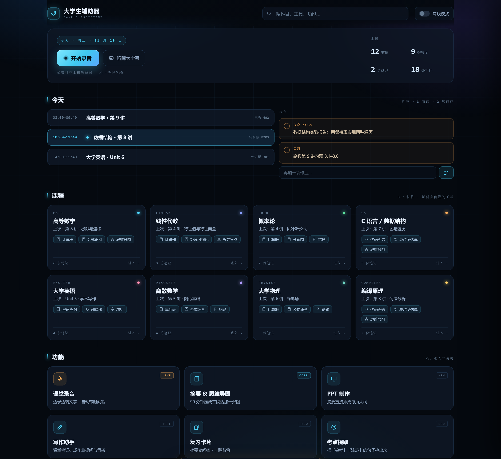
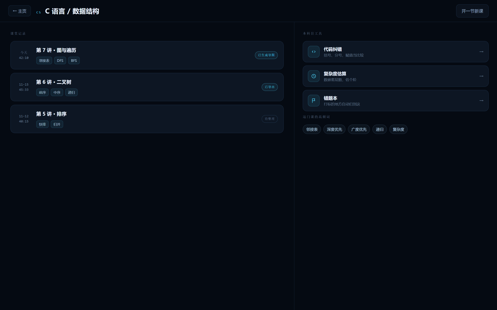
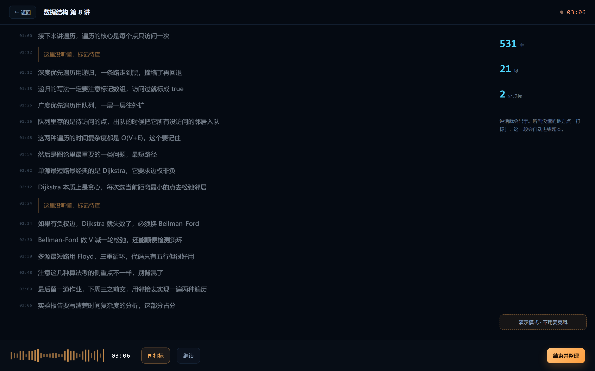
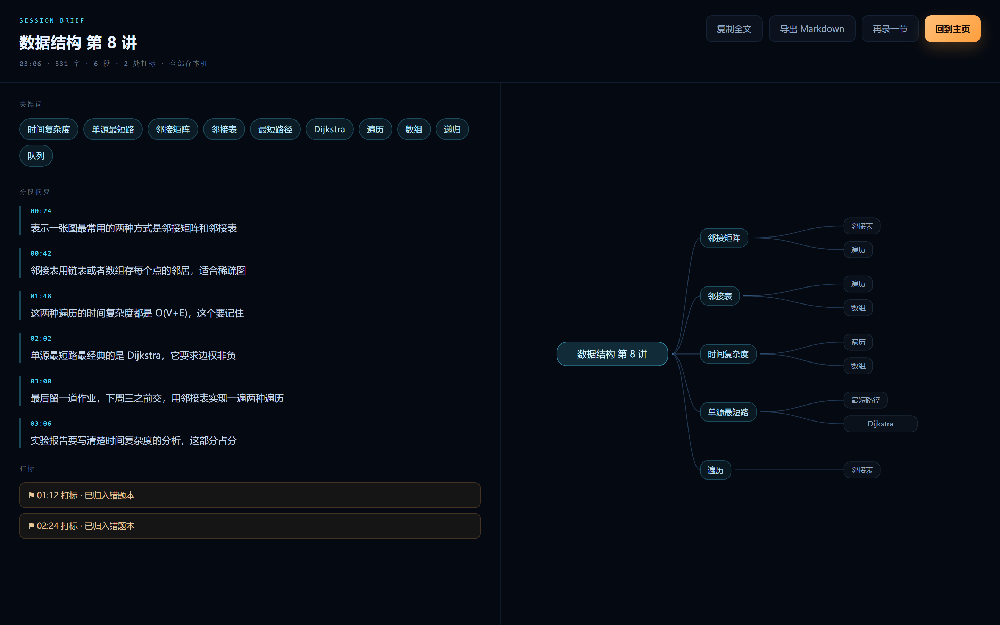
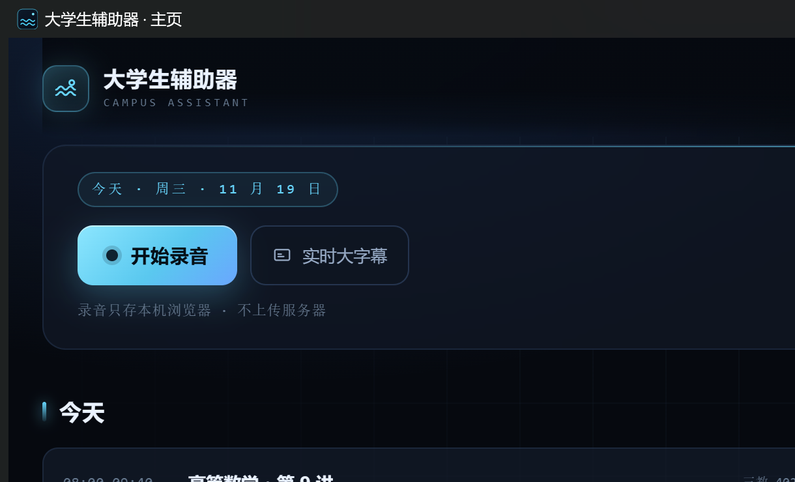
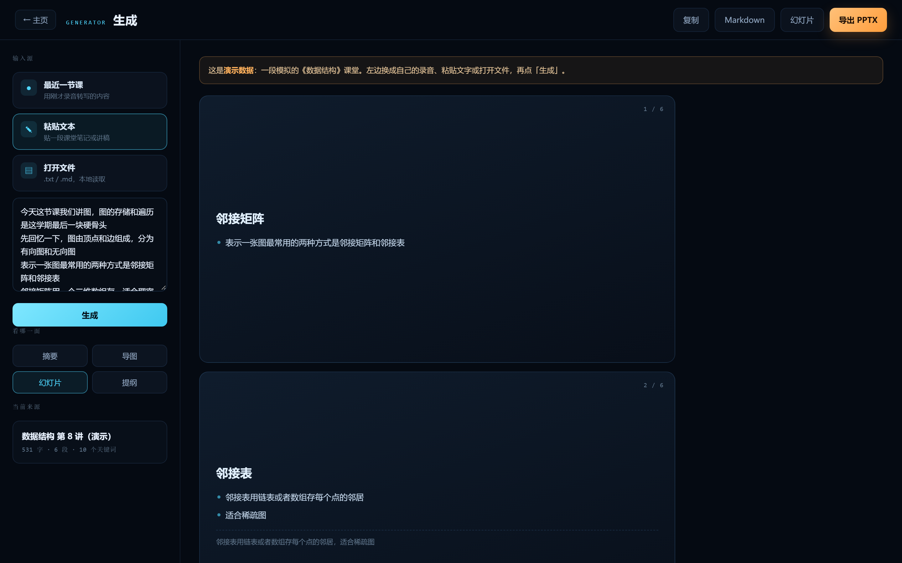
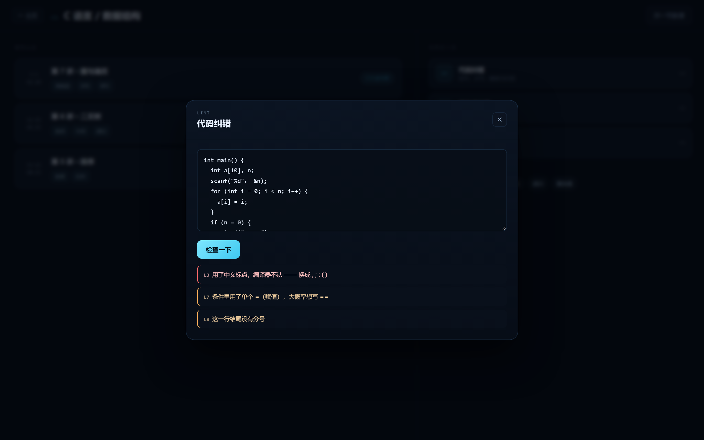

# 大学生辅助器 · Campus Assistant

> 一节课进来，一份能复习的产物出去。

一个给学生用的课堂工具：**录音 → 转写 → 分段摘要 → 思维导图 → 复习卡片 / 考点 / PPT 幻灯片 / 写作提纲**，外加 8 个科目各自的专属小工具。

单文件网页版零依赖、双击即用；另附一个 Electron 壳，可打包成 Windows 桌面程序。



**三步跑起来**：

```bash
git clone https://github.com/shan-gui-yao/student-tool.git
cd student-tool
# 双击 index.html（用 Edge 或 Chrome 打开）
```

没有构建、没有 npm、没有后端。想看效果但不想录音，就在地址栏加 `?studio=rec`。

---

## 一、这个项目解决什么问题

上课时的原始信息是**声音**，但复习需要的是**结构化文字和一张图**。中间那一步"整理"，学生通常要重做一遍：听录音、写笔记、画导图、抄错题。

拆开看是三个具体痛点：

| 痛点 | 现状 | 本项目怎么处理 |
|---|---|---|
| **课堂内容留不住** | 录音存了但从不回听，板书拍了但不看 | 录音同时出带时间戳的转写，结束自动分段摘要 + 一张导图 |
| **课后整理耗时** | 一节 90 分钟的课，整理要再花 40 分钟 | 摘要、关键词、导图全部本地算法即时生成，一键导出 Markdown |
| **工具散落各处** | 计算器、错题本、单词、翻译各下一个 App，用时找不到 | 按科目组织：进"高等数学"就看到计算器和公式表，进"C 语言"就看到代码纠错 |

核心取舍：**不做"AI 全家桶"，只做一条流水线**。所有摘要和导图都是本地规则算法，不调用任何大模型 API——断网也能出结果。

---

## 二、主要功能

### 2.1 主线：一节课的流水线

| 环节 | 能力 | 实现 |
|---|---|---|
| 录音 | 开始/暂停/停止，实时波形与计时 | `MediaRecorder` |
| 转写 | **桌面版：本地 Whisper**（离线、带时间戳）；网页版：浏览器语音接口 | 见「已知限制」 |
| 打标 | 听到没懂的地方点一下，插入一条带时间戳的标记 | 本地 |
| 分段摘要 | 按停顿与长度切段，每段挑一句最相关的话 | 本地算法 |
| 关键词 | n-gram 统计 + 学科词表加权 + 碎片剔除 | 本地算法 |
| 思维导图 | 三级树形图，可导出 | 手写 SVG |
| 导出 | Markdown（关键词 / 摘要 / 打标 / 全文） | `Blob` 下载 |

### 2.2 八个科目，各自的工具

| 科目 | 专属工具 |
|---|---|
| 高等数学 / 线性代数 / 概率论 | 计算器、公式速查、错题本 |
| C 语言 · 数据结构 | 代码纠错、复杂度估算、错题本 |
| 编译原理 | 代码纠错、错题本 |
| 大学英语 | 单词查询（32 词本地词库）、错题本（翻译器是占位） |
| 离散数学 | 公式速查、错题本 |
| 大学物理 | 计算器、公式速查、错题本 |

进入科目页可以看到：这门课的课堂记录、按科目配置的工具、高频词。



### 2.3 九个功能入口

首页「功能」区一共 9 张卡，**8 个能用，1 个是占位**（✅ 可用 / ⚠️ 有条件 / ❌ 未实现）：

| 功能 | 状态 | 说明 |
|---|---|---|
| 课堂录音 | ✅ | 见 2.1 |
| 摘要 & 思维导图 | ✅ | 见 2.1；也从这里进「生成」页 |
| PPT 制作 | ✅ | 每段摘要生成一页，导出**真正的 .pptx**（13.33×7.5 宽屏），另可导出可放映的 HTML 幻灯片 |
| 写作助手 | ✅ | 生成"引言 / 分节 / 结论"三级提纲，只给结构不给正文 |
| 复习卡片 | ✅ | 由摘要生成问答卡，翻卡 + "记住了" + 进度条 |
| 考点提取 | ✅ | 规则挑出"会考 / 注意 / 作业"类句子，按考点·易错·作业分类 |
| 错题本 | ✅ | 每科条目；从科目页录的课，打标内容会自动追加进来 |
| 成绩计算 | ✅ | 加权平均 + 4.0 分段绩点，改数字即时重算 |
| 翻译 | ❌ | 仅占位说明，未接入任何翻译服务 |

### 2.4 其他

- **今天**：今日课表 + 可勾选/可新增的待办
- **搜索**：命令面板式搜索，覆盖科目、功能、课堂记录
- **离线模式**：打开后只录音不转写（真的会跳过转写）
- **实时大字幕**：转写放大到全屏的说明入口
- **隐私**：录音前弹窗要求确认"已告知在场的人"；数据只在内存；一键销毁

桌面宽度会自动切多列，手机宽度自动堆叠（`docs/mobile-home.png` 是 390px 下的样子）：





---

## 三、安装方法

### 方式一：浏览器直接打开（推荐，零依赖）

```bash
git clone https://github.com/shan-gui-yao/student-tool.git
cd student-tool
```

双击 `index.html`，用 **Edge 或 Chrome** 打开即可。

不需要 Node、不需要 npm、不需要构建——整个应用就是一个 HTML 文件。

### 方式二：本地起静态服务器

有些浏览器对 `file://` 下的麦克风权限比较严格，起个服务器更稳：

```bash
python -m http.server 8080
# 然后浏览器打开 http://localhost:8080
```

### 方式三：打包成 Windows 桌面程序（可选）

仓库里的 `desktop/` 是 Electron 壳。因为 Electron 运行时约 150 MB，不放进仓库，需要自己下载拼装：

1. 从 [electron releases](https://github.com/electron/electron/releases) 或国内镜像
   `https://registry.npmmirror.com/-/binary/electron/` 下载 `electron-vX.Y.Z-win32-x64.zip`
2. 解压，得到 `electron.exe`、`resources/` 等文件
3. 新建 `resources/app/`，把下面三个文件放进去：
   - `desktop/package.json`
   - `desktop/main.js`
   - 仓库根目录的 `index.html`
4. 删掉 `resources/default_app.asar`
5. 把 `electron.exe` 重命名为 `CampusAssistant.exe`
6. 双击运行

> ⚠️ **两个坑**（实测踩过）：
> 1. **exe 所在路径不能含中文**。放在含中文的目录（比如直接用项目名建的文件夹）下会静默退出，没有日志没有报错；换到纯英文目录就正常。入口可以用中文快捷方式，但目录名要英文。
> 2. 如果环境里设了 `ELECTRON_RUN_AS_NODE=1`，`electron.exe` 会退化成普通 Node，报 `Cannot find module 'electron'`。启动前清掉这个变量。

打包后的样子（窗口无菜单栏，单实例）：



---

## 四、使用方法

### 4.1 录一节课

1. 首页点 **开始录音**
2. 弹窗要求确认"已告知在场的人"（勾选后才能继续）
3. 进入工作台：左侧实时转写，右侧字数/句数/打标数
4. 听到没懂的地方点 **⚑ 打标**
5. 点 **结束并整理** → 关键词、分段摘要、思维导图

### 4.2 没有麦克风也能看

工作台右侧有 **演示模式**，会播一段 21 句的《数据结构》模拟课堂，完整跑完整个流程。

### 4.3 整理页能做什么

- **复制全文**：把 Markdown 塞进剪贴板
- **导出 Markdown**：下载 `.md`
- 右侧是自动生成的思维导图

### 4.4 生成 PPT / 写作提纲

首页「功能」区点 **PPT 制作**、**写作助手** 或 **摘要 & 思维导图**，都会进同一个「生成」页：

1. 左边选输入源：**最近一节课** / **粘贴文本** / **打开 .txt .md 文件**
2. 点 **生成**
3. 右边四个标签切换：摘要、导图、幻灯片、提纲
4. 右上角导出：**复制**、**Markdown**、**幻灯片（HTML）**、**导出 PPTX**

PPTX 是真正的 Office 文件（13.33×7.5 宽屏，标题 + 要点版式），用 PowerPoint / WPS / Keynote 都能直接打开。



### 4.5 用 URL 参数直达（方便演示和截图）

| 参数 | 作用 | 例 |
|---|---|---|
| `?studio=rec` | 直接进录音工作台（带演示数据） | `index.html?studio=rec` |
| `?studio=brief` | 直接进整理页 | `index.html?studio=brief` |
| `?subj=<id>` | 直接进科目页 | `?subj=math`（math/lina/prob/cs/eng/disc/phys/comp） |
| `?tool=<id>` | 直接打开某个工具 | `?tool=gpa`、`?tool=review`、`?tool=code` |
| `?gen=sum` / `?gen=map` / `?gen=deck` / `?gen=outline` | 打开生成器并切到对应标签 | `?gen=deck` |
| `?q=<词>` | 打开搜索面板 | `?q=图` |
| `?snap=1` | 关掉所有过渡动画（截图用） | 与上面任意参数组合 |

---

## 五、输入输出示例

### 5.1 一节课 → 整理结果

**输入**：录音转写（下面是内置演示片段的前几行，实际共 21 句）

```
[00:06] 今天这节课我们讲图，图的存储和遍历是这学期最后一块硬骨头
[00:18] 先回忆一下，图由顶点和边组成，分为有向图和无向图
[00:30] 表示一张图最常用的两种方式是邻接矩阵和邻接表
[00:42] 邻接矩阵用一个二维数组存，适合稠密图，空间是 n 的平方
...
[03:06] 实验报告要写清楚时间复杂度的分析，这部分占分
```

**输出：关键词**（本地 n-gram + 学科词表，不需要联网）

```
时间复杂度 · 单源最短路 · 邻接矩阵 · 邻接表 · 最短路径
Dijkstra · 遍历 · 数组 · 递归 · 队列
```

**输出：分段摘要**（每段挑一句最相关的话，带时间戳）

```
00:24  表示一张图最常用的两种方式是邻接矩阵和邻接表
00:42  邻接表用链表或者数组存每个点的邻居，适合稀疏图
01:48  这两种遍历的时间复杂度都是 O(V+E)，这个要记住
02:02  单源最短路最经典的是 Dijkstra，它要求边权非负
03:00  最后留一道作业，下周三之前交，用邻接表实现一遍两种遍历
03:06  实验报告要写清楚时间复杂度的分析，这部分占分
```

**输出：思维导图**（SVG 三级树）

```
数据结构 第 8 讲
├── 邻接矩阵 ── 邻接表 / 遍历
├── 邻接表   ── 遍历 / 数组
├── 时间复杂度 ── 遍历 / 数组
├── 单源最短路 ── 最短路径 / Dijkstra
└── 遍历     ── 邻接表
```

**输出：导出的 Markdown**

```markdown
# 数据结构 第 8 讲

时长 03:06 ｜ 531 字 ｜ 2 处打标 ｜ 由「大学生辅助器」整理

## 关键词
时间复杂度 · 单源最短路 · 邻接矩阵 · 邻接表 · 最短路径 · Dijkstra · 遍历 · 数组 · 递归 · 队列

## 分段摘要
- [00:24] 表示一张图最常用的两种方式是邻接矩阵和邻接表
- [00:42] 邻接表用链表或者数组存每个点的邻居，适合稀疏图
...

## 打标
- [01:12] 这里没听懂，待查
- [02:24] 这里没听懂，待查

## 全文
[00:06] 今天这节课我们讲图，图的存储和遍历是这学期最后一块硬骨头
...
```

### 5.2 代码纠错

**输入**

```c
int main() {
  int a[10], n;
  scanf("%d"， &n);          // 中文逗号
  for (int i = 0; i < n; i++) {
    a[i] = i;
  }
  if (n = 0) {               // 单等号
    printf("empty")          // 缺分号
  }
  return 0;
}
```

**输出**

```
L3  用了中文标点，编译器不认 —— 换成 , ; : ( )
L7  条件里用了单个 =（赋值），大概率想写 ==
L8  这一行结尾没有分号
```

规则只有四条：中文标点、括号配对、`=` 当 `==`、行尾缺分号。它不做语义分析。

### 5.3 成绩计算

**输入**（6 门课，可改学分和分数）

```
高等数学 4 学分 88 分     线性代数 3 学分 92 分
概率论   3 学分 79 分     大学英语 2 学分 86 分
数据结构 4 学分 90 分     大学物理 3 学分 74 分
```

**输出**

```
加权平均 85.2    4.0 绩点 3.48    总学分 19
```

### 5.4 计算器

```
输入：12*(3+4)/2
输出：42
输入：50%*80
输出：40
```

### 5.5 文本 → PPTX

**输入**：把下面这段直接粘进「生成」页的文本框（一行一句最准；只有一整段时会按句号切）

```
今天这节课我们讲图，图的存储和遍历是这学期最后一块硬骨头
表示一张图最常用的两种方式是邻接矩阵和邻接表
邻接表用链表或者数组存每个点的邻居，适合稀疏图
这两种遍历的时间复杂度都是 O(V+E)
单源最短路最经典的是 Dijkstra，它要求边权非负
```

**操作**：粘贴 → 点「生成」→ 切到「幻灯片」标签 → 点右上角「导出 PPTX」

**输出文件**：`<来源标题>.pptx`（例如 `粘贴的文本.pptx`、`数据结构 第 8 讲（演示）.pptx`）

| 属性 | 值 |
|---|---|
| 尺寸 | 13.33 × 7.5 英寸（16:9 宽屏） |
| 版式 | 标题 + 内容（PowerPoint 自带的 "Title and Content"） |
| 页数 | 等于分段数，最多 6 页 |
| 体积 | 约 100 KB |
| 兼容 | PowerPoint / WPS / Keynote 直接打开 |

**逐页内容**（以 21 句的内置演示为例，共 6 页，前 4 页如下；标题取该句命中的关键词，要点按逗号切分，没有逗号的整句作单条要点）：

```
P1  邻接矩阵      表示一张图最常用的两种方式是邻接矩阵和邻接表
P2  邻接表        邻接表用链表或者数组存每个点的邻居 / 适合稀疏图
P3  时间复杂度    这两种遍历的时间复杂度都是 O(V+E)
P4  单源最短路    单源最短路最经典的是 Dijkstra / 它要求边权非负
```

同一份内容还可以导出 **Markdown**（完整文字）和 **HTML 幻灯片**（全屏放映、可直接打印成 PDF）。



---

## 六、技术说明

- **单文件前端**：`index.html` 约 3560 行、266 KB，内联 CSS + 原生 JS，**零依赖、无构建、无 CDN**（其中约 40 KB 是内嵌的 PPTX 模板）
- **关键词**：2–6 字 n-gram 统计 → 学科词表加权 → 碎片剔除（几乎总和长词同时出现的不算独立词）→ 重叠去重
- **摘要**：按时间间隔与长度切段，每段取命中关键词最多的一句（抽取式，不是生成式）
- **导图**：把段落关键词组织成三级树，手写 SVG 绘制
- **代码纠错 / 复杂度**：正则规则与循环嵌套计数，明确标注为"粗估"
- **录音**：`MediaRecorder` + `AnalyserNode` 波形
- **转写**：`webkitSpeechRecognition`
- **PPTX 导出**：零依赖的 OOXML 生成器 —— 用一份 python-pptx 生成的模板当骨架，替换幻灯片 XML，再手写 ZIP（stored 不压缩）打包；产物已用 python-pptx 回读验证
- **桌面壳**：Electron，窗口无菜单、单实例、外链交给系统浏览器

## 七、目录结构

```
.
├── index.html          # 整个应用（网页版，3550 行单文件）
├── desktop/
│   ├── main.js         # Electron 主进程（含本地转写通道）
│   ├── preload.js      # 只暴露 transcribe / whisperStatus
│   └── package.json
├── tools/              # PPTX 生成器（Node 下可单独跑）
│   ├── gen.js          # Node 版：node tools/gen.js 生成样例
│   ├── browser.js      # 浏览器版（打包进 index.html 的就是它）
│   └── parts.json      # 从 python-pptx 提取的 OOXML 模板部件
├── docs/
│   ├── DESIGN.md       # 设计取舍说明
│   └── *.png           # README 用图
├── .gitattributes      # 统一 LF，二进制文件标 binary
├── .gitignore
├── LICENSE
└── README.md
```


## 八、已知限制（请先看这一节）

这个项目是**个人练习项目**，不是生产级产品，下面这些是真的没做到：

1. **数据不落盘**。所有录音、转写、笔记都在内存里，刷新或关掉页面就没了。没有 localStorage / IndexedDB。
2. **转写分两条路**。桌面版走本地 Whisper（离线、不花钱、带时间戳），但 base 模型会有同音错字（「遍历」可能被识别成「便利」）；网页版走浏览器语音接口，多数网络环境下不可用。**录音本身始终可用**。
3. **摘要和考点是规则算法，不是大模型**。摘要来自原句抽取，不会改写；考点靠"会考/注意/作业"这类词命中，不理解语义。
4. **翻译没有实现**，只有入口。
5. **大量示例数据**。8 个科目的课堂记录、错题、公式都是内置的演示内容，不是真实抓取；生成页在没有录音时会自动加载一份并明确标注"演示数据"。
6. **桌面版体积 357 MB**（Electron 运行时占绝大部分），且从含中文的路径启动会失败；仓库里只放壳，运行时需要自己下载拼装。
7. **「实时大字幕」只有说明抽屉**，没有真正实现全屏字幕。
8. **复习卡片、考点提取都只针对当前这一节课**，不跨课、不做遗忘曲线调度。
9. **没有自动化测试**。验收靠手动点击和截图。

## 九、Roadmap

- [ ] 用 IndexedDB 做本地持久化，刷新不丢
- [ ] 接入离线 ASR（如 whisper.cpp）替掉 Web Speech
- [ ] 翻译器接入
- [ ] 课程表可编辑

## License

[MIT](LICENSE)

---

*界面文案、算法实现与 `docs/DESIGN.md` 都是边做边改的过程记录，保留了走弯路的痕迹。*
